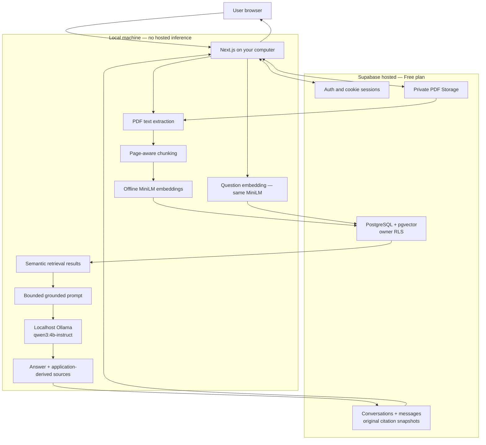

# Groundwork — RAG Knowledge Assistant

A private PDF knowledge assistant built with Next.js, Supabase and local AI. Upload documents, ask grounded questions, inspect the source evidence, and resume saved conversations. The RAG pipeline is implemented directly in TypeScript without a RAG framework.

**Release target:** a local portfolio application with a Supabase Free backend. Generation runs on the same machine as Next.js; this is not an unattended cloud RAG deployment. No paid AI APIs are used.

## Features

- Email/password authentication with cookie sessions and protected pages/APIs.
- Private, owner-only PDF upload, listing and coordinated deletion.
- Page-aware PDF extraction and deterministic chunking with overlap.
- Offline MiniLM embeddings: normalized 384-dimensional vectors.
- Transactional ingestion/re-ingestion into PostgreSQL and pgvector.
- Exact cosine retrieval across your ready documents or one selected document.
- Grounded local Ollama answers, with an insufficient-evidence response before generation when retrieval is empty.
- Expandable sources derived from the actual context passages, including filenames, physical PDF pages and excerpts.
- Saved conversations and original citation snapshots; retries and duplicate-request protection.
- Responsive workspace with collapsible navigation, contextual details, account settings, and locally persisted Light/Dark/System themes.
- Explicit Documents, General AI and Auto chat modes. General answers use only the local model, are clearly labelled, and never receive document citations; Documents mode abstains when evidence is insufficient.
- Document cards with an Upload → Process for AI → Ready workflow and direct document-scoped chat links.
- Dashboard summaries from your actual library and conversation history, plus a local model availability check.
- Mock mode for inexpensive interface development, plus optional extraction/chunk/retrieval inspectors for learning.

## Technology stack

| Area | Implementation |
| --- | --- |
| Application | Next.js 15 App Router, React 19, TypeScript, Tailwind CSS 4 |
| Authentication/backend | Supabase Auth, private Storage, PostgreSQL, pgvector |
| PDF extraction | `pdf-parse`, running server-side |
| Embeddings | `@huggingface/transformers`, `Xenova/all-MiniLM-L6-v2`, CPU/q8 |
| Generation | Local Ollama, `qwen3:4b-instruct`, GGUF/Q4_K_M |
| Validation | Node test runner, TypeScript, ESLint, production build |

## Architecture



Storage holds original PDFs. PostgreSQL holds metadata, chunks, vectors and conversations. Next.js downloads only the signed-in user's PDF, performs local inference, and calls Supabase with that user's ordinary session. See [architecture details](docs/architecture.md).

## Screenshots

These production screenshots use synthetic learning content and exclude personal account identifiers.


See [screenshot guidance](docs/screenshots/README.md) before adding more captures.

See [the workspace UI guide](docs/ui-ux.md) for navigation, themes, document actions and validation notes.

See [the final UI refinement report](docs/final-ui-ux.md) for the polished shell, Account/Settings pages, interaction changes and final validation results.

## Local setup

Use Node.js **24 or later**, npm, Git, an existing Supabase Free project and Ollama. This project contains native PDF/ONNX dependencies, so run it in a Node environment, not an Edge runtime.

For a fresh checkout, install the locked dependencies deliberately:

```bash
npm ci
```

Copy `.env.example` to `.env.local` and fill the two public Supabase values from your own project dashboard. Never share secrets in an issue, chat or screenshot. Do not replace the publishable key with a secret/service-role key.

Prepare the embedding artifacts once, deliberately:

```bash
npm run embeddings:prepare
```

This command downloads four public files from a pinned Hugging Face model revision into ignored `.setup-cache/transformers/`. It is not a hosted inference request. Runtime embedding generation disables remote models and requires those files to already exist. Do not rerun installation/download steps on an already prepared checkout unless needed.

## Supabase setup

1. Use a **Free** project with email/password Auth and email confirmation enabled.
2. Set Auth Site URL to `http://localhost:3000`; allow `http://localhost:3000/auth/callback` as a redirect URL. Open confirmation links in the same browser that started signup (PKCE verifier cookie). Default email delivery can restrict recipients to project team members and impose rate limits; do not disable confirmation or upgrade merely to run a test.
3. On a **fresh project only**, review and run `supabase/storage/documents.sql` to create the private `documents` bucket and owner policies. It limits uploads to PDFs of at most 4 MiB.
4. Apply these reviewed migrations **once, in order**, using the SQL Editor or your migration workflow:

| File | Purpose |
| --- | --- |
| `20261009094113_knowledge_base_persistence.sql` | vector extension, documents/chunks, ingestion/deletion RPCs, coordinated Storage delete policy |
| `20261009111153_semantic_retrieval.sql` | invoker cosine-search RPC |
| `20261009212314_conversation_persistence.sql` | conversations/messages, RLS, atomic turn RPCs |
| `20261011053350_restrict_internal_helper_execution.sql` | restrict the optional dashboard RLS helper's client execution |

All are in `supabase/migrations/`. Existing projects must check migration history first; do not rerun bucket creation or old migrations blindly. The ingestion migration replaces one Storage delete policy and its RPCs perform scoped data replacement/deletion during explicit app actions. Read the full SQL before applying it. No migration requires a service-role key in the application. Explicit authenticated grants are included because RLS and Data API exposure are separate controls.

The embedding column is `extensions.vector(384)`. A different embedding model/revision requires a deliberate schema/data migration, not just an environment switch.

## Ollama setup

Install Ollama manually from [the official website](https://ollama.com/download). Model installation is an explicit user step, never an application action:

```bash
ollama pull qwen3:4b-instruct
ollama list
```

Skip the pull if the reviewed model is already installed. The [official model tag](https://ollama.com/library/qwen3:4b-instruct) is approximately 2.5 GB. Allow additional memory for inference and the context/KV cache; CPU generation works but can be slow, and GPU offload depends on available VRAM and Ollama's device support. The app uses a bounded 8,192-token context, not the tag's advertised maximum context.

Keep Ollama listening on loopback. Disable Ollama cloud features in **Ollama's own process environment** with `OLLAMA_NO_CLOUD=1` and restart that process; setting it only in Next.js does not configure Ollama. See [Ollama's FAQ](https://docs.ollama.com/faq). Do not expose port 11434 publicly, add a tunnel or configure cloud models.

Start the Ollama desktop app, or use `ollama serve` if no server is already running. Then set `LLM_MODE=local` in `.env.local` and start Next.js:

```bash
npm run release:check -- --runtime
npm run dev -- --hostname 127.0.0.1
```

Open `http://localhost:3000`. For a production-mode local run:

```bash
npm run build
npm run start -- --hostname 127.0.0.1
```

Stop the dev server before building/running production in the same checkout. Never bind the app to a public interface as a shortcut to deployment.

## Environment variables

| Name | Purpose |
| --- | --- |
| `NEXT_PUBLIC_SUPABASE_URL` | HTTPS project origin, without credentials/path/query |
| `NEXT_PUBLIC_SUPABASE_PUBLISHABLE_KEY` | Browser-safe `sb_publishable_…` key; access still requires Auth + RLS |
| `LLM_MODE` | `mock` by default; explicitly choose `local` for document answers |
| `OLLAMA_BASE_URL` | Only `http://127.0.0.1:11434` or `http://localhost:11434` |
| `OLLAMA_MODEL` | Only reviewed `qwen3:4b-instruct` |
| `OPENAI_API_KEY` | Empty reserved placeholder; OpenAI provider is disabled |

`.env.local` is ignored and must remain untracked. Only the two `NEXT_PUBLIC_` Supabase settings are intended for the browser. Ollama configuration/model checks run server-side. Requests use the canonical loopback IP with redirects blocked. The installed manifest digest must match the reviewed model before private context is sent. A key never selects a provider; even explicit `LLM_MODE=openai` is rejected without a network request.

## How the pipelines work

**Ingestion:** upload a private PDF → click Ingest → authenticated Storage download → extract text by physical page → chunk at natural boundaries (1,200 characters, up to 200 overlap) → batch local embeddings → transactionally persist metadata/chunks/vectors. Re-ingest atomically replaces a document's chunks; failures keep the previously ready version. No OCR is performed.

**Retrieval:** a question is embedded with the same pinned MiniLM revision, mean pooling and normalization. The invoker RPC applies owner/ready/model filters and compares vectors with pgvector cosine distance `<=>`. Similarity is `1 - distance`; larger values indicate closer vector directions, not correctness probabilities. Default top-k is 5 and threshold is 0.30; the learning inspector allows bounded adjustments. Exact search is appropriate for this small project; there is no HNSW/IVFFlat index.

**Generation:** the current question plus relevant owned passages form a JSON reference context, ordered by similarity, deduplicated by chunk ID and capped at 6,000 context bytes / 7,000 prompt bytes. Empty context returns an insufficient-information message without contacting Ollama. The system prompt confines answers to evidence and treats document text as untrusted reference material. Ollama receives only a system/user pair, uses temperature 0, and has a 120-second timeout and 384-token output cap. Truncated/malformed responses fail visibly. Prompt instructions reduce hallucination but do not eliminate it.

**Citations:** the application attaches sources from the passages actually included in the prompt, never model-invented identities. Each includes document/chunk IDs, filename, chunk index, pages, rank, similarity and a shortened exact excerpt. The UI groups by document without discarding distinct chunk evidence. Similarity is relevance, not certainty; verify the passages yourself.

**Saved chats:** save the pending question before generation → run RAG → atomically save the answer and citation snapshot → mark the question completed. Request IDs prevent duplicate generation; attempt IDs and a five-minute lease permit safe interrupted retries. Completed replay returns the saved result. Failed questions have no fabricated assistant answer. History is for storage/display continuity: prior chat messages are **not** passed to the model, so write standalone follow-up questions.

**Deletion:** marking a document as deleting excludes it from retrieval, then the app removes Storage content and database metadata. Chunk/vector rows cascade-delete. Partial cleanup remains visible for retry. Historic saved citation excerpts survive PDF deletion; delete the conversation to remove its saved messages/evidence. An unavailable saved document scope is rejected, never silently broadened.

## Security design

- Verified cookie sessions protect routes; server APIs revalidate the user with `auth.getUser()`.
- Owner predicates in RLS protect documents, chunks, conversations and messages independently of application filters.
- Private Storage requires owner ID and user-folder agreement. Paths use an owner folder plus random UUID/sanitized basename. No public PDF URL or service-role key is used.
- Application RPCs use `SECURITY INVOKER`, an empty search path and narrowly scoped authenticated permissions. The optional privileged auto-RLS helper has no client execute grant.
- Important inputs and actual request-body sizes are checked server-side. Upload validation checks extension/MIME, size and PDF header; corrupt/encrypted/image-only files fail gracefully in extraction.
- Same-origin mutation checks, safe redirect allowlists, private/no-store responses, plain-text React rendering and response security headers reduce browser risks.
- No prompt, PDF text, key, auth code or raw stack trace is logged by application handlers. Auth identities and excerpts can still be visible in the UI: redact them from screenshots.
- Local inference only; no automatic model downloads or hosted provider fallback.

See [security review and residual risks](docs/security.md) and the [two-real-user acceptance plan](docs/testing.md). A real second-user browser test remains pending; synthetic JWT/RLS tests are useful but are not described as its replacement.

## Zero-paid-API design and deployment

MiniLM/Ollama inference uses your machine; Supabase uses the Free plan. Initial package/model downloads and normal Supabase Auth/Storage/database traffic require internet access, but inference uses no cloud model endpoint. Free quotas, hardware, electricity and internet connectivity still impose practical limits; monitor project quotas and never enable paid features automatically.

A remote Next.js server's localhost is **that remote server**, not your PC. Vercel cannot call your local Ollama, and native embedding caches also require deployment-specific provisioning. Recommended portfolio release: source code, architecture diagram, redacted screenshots and a recorded/local walkthrough. A separate static showcase is the safest public presentation; a mock app can demonstrate auth/chat only after deployment-specific review, without advertising full document AI. Do not expose local Ollama or deploy automatically. See [release strategy](docs/release.md).

## Testing

After preparing the local embedding artifacts:

```bash
npm run typecheck
npm run lint
npm test
npm run build
npm run release:check -- --runtime
npm audit --omit=dev
```

The automated suite blocks real network access for inference tests and uses offline Supabase/Auth transports. It also runs real local PDF parsing and MiniLM semantic tests. Ollama tests use deterministic transports; live model output is validated separately. `release:check` validates settings without printing values or downloading/loading models; `--runtime` adds a read-only loopback model inventory check. A successful configuration check is not proof of RLS/deployed schema or two-real-user isolation.

See [manual acceptance scenarios](docs/testing.md) and [Phase 13 changes/results](docs/phase-13.md). Generated test PDFs and private proof files belong in ignored `.setup-cache/`, not the public repository.

## Project structure

```text
src/app/                  App Router pages, protected layouts and API routes
src/components/           Auth, dashboard shell, documents, chat and sources
src/lib/supabase/         Public/browser and authenticated SSR client utilities
src/lib/storage/          Private upload/download validation
src/lib/pdf/              Server-side extraction
src/lib/rag/              Chunking, context assembly, sources and answer pipeline
src/lib/embeddings/       Pinned offline model, batching and query adapter
src/lib/retrieval/        Validated invoker-RPC search
src/lib/knowledge/        Persistent ingestion and coordinated deletion
src/lib/conversations/    Atomic turns, history and owner-filtered repository
src/lib/ai/               Explicit mock/local/disabled OpenAI provider layer
scripts/                  Tests, public synthetic fixtures and release checks
supabase/                 Reviewed migrations, Storage setup and SQL checks
docs/                     Architecture, security, acceptance and release guides
```

## Known limitations

- Local, small-scale application; not an internet-facing multi-tenant production service.
- English-oriented MiniLM, character-based chunking, 512-token input capacity and approximate semantic relevance. Oversized token sequences are rejected rather than silently truncated.
- PDFs capped at 4 MiB, 100 pages and 200,000 extracted characters; up to 500 persisted chunks. No OCR, images or encrypted-PDF support.
- Parsing has size/result limits but no hard hostile-PDF CPU/memory sandbox. Use trusted learning documents locally.
- Process-local inference concurrency guards; no distributed rate limiter, queue or background ingestion jobs.
- Short non-streaming generation, no reranking/hybrid retrieval, no conversation memory sent to the model.
- Citations prove input provenance, not claim-by-claim entailment. Prompt injection/hallucination cannot be completely prevented by wording alone.
- Two-real-user acceptance remains pending; current automated/offline and database identity tests are documented separately.
- Supabase default confirmation email restrictions and disabled leaked-password protection remain constraints; no paid Auth upgrade is enabled.
- The production dependency audit is clean; the full audit retains an unpatched development-only `braces` advisory chain. See the security guide before processing untrusted build patterns.

## Future improvements

Only after deliberate review: token-aware chunking, OCR with an explicit privacy/cost plan, streaming, bounded conversational context, retrieval evaluation, stronger parsing isolation, distributed abuse controls and scalable indexing when measurement justifies it. Hosted inference/deployment would require a separate infrastructure and zero-cost decision.

## Portfolio description and skills

> Groundwork is a full-stack document knowledge assistant that implements RAG manually: private authenticated PDF ingestion, page-aware chunking, offline embeddings, owner-isolated pgvector retrieval, grounded local LLM answers, verifiable source evidence and resilient persistent chat history.

Demonstrates full-stack TypeScript/React, authenticated SSR, PostgreSQL modeling/transactions/RLS, secure Storage, vector search, local model integration, prompt/evidence design, idempotent APIs, accessibility, regression testing and clear release documentation.

## License

No project license has been selected. Choose one deliberately before distributing the code for reuse; do not infer a license from public availability. Dependencies and model weights retain their own licenses (inspect their upstream repositories/model cards before redistribution).
