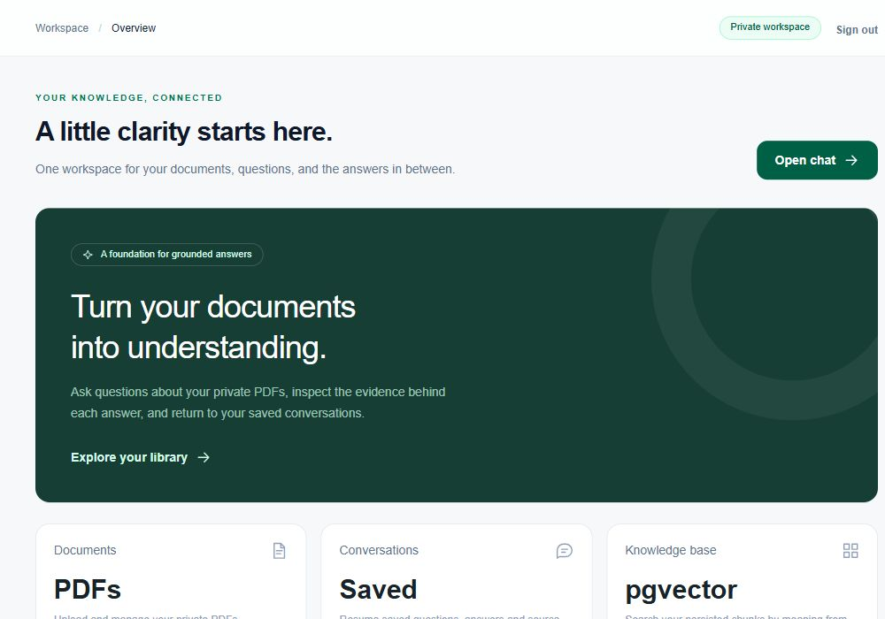
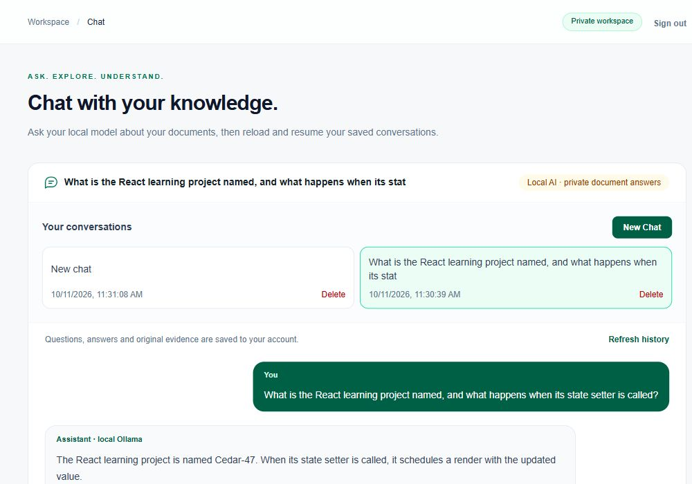
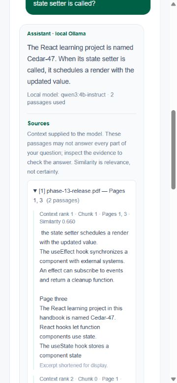

# Groundwork — RAG Knowledge Assistant

A private PDF knowledge assistant built with Next.js, Supabase and local AI. Upload documents, ask grounded questions, inspect the source evidence, and resume saved conversations. The RAG pipeline is implemented directly in TypeScript without a RAG framework.

**Release target:** a local portfolio application with a Supabase Free backend. Generation runs on the same machine as Next.js; this is not an unattended cloud RAG deployment. No paid AI APIs are used.

## Features

- Email/password authentication with cookie sessions and protected pages/APIs.
- Private, owner-only PDF upload, listing and coordinated deletion.
- Page-aware PDF extraction and deterministic chunking with overlap.
- Offline MiniLM embeddings: normalized 384-dimensional vectors.
- Transactional ingestion/re-ingestion into PostgreSQL and pgvector.
- Exact cosine retrieval across your ready documents or one selected document.
- Grounded local Ollama answers, with an insufficient-evidence response before generation when retrieval is empty.
- Expandable sources derived from the actual context passages, including filenames, physical PDF pages and excerpts.
- Saved conversations and original citation snapshots; retries and duplicate-request protection.
- Responsive workspace with collapsible navigation, contextual details, account settings, and locally persisted Light/Dark/System themes.
- Explicit Documents, General AI and Auto chat modes. General answers use only the local model, are clearly labelled, and never receive document citations; Documents mode abstains when evidence is insufficient.
- Document cards with an Upload → Process for AI → Ready workflow and direct document-scoped chat links.
- Dashboard summaries from your actual library and conversation history, plus a local model availability check.
- Mock mode for inexpensive interface development, plus optional extraction/chunk/retrieval inspectors for learning.

## Technology stack

| Area | Implementation |
| --- | --- |
| Application | Next.js 15 App Router, React 19, TypeScript, Tailwind CSS 4 |
| Authentication/backend | Supabase Auth, private Storage, PostgreSQL, pgvector |
| PDF extraction | `pdf-parse`, running server-side |
| Embeddings | `@huggingface/transformers`, `Xenova/all-MiniLM-L6-v2`, CPU/q8 |
| Generation | Local Ollama, `qwen3:4b-instruct`, GGUF/Q4_K_M |
| Validation | Node test runner, TypeScript, ESLint, production build |

## Documentation

Start at the **[documentation index](docs/README.md)**. Each topic has its own file:

| Topic | Guide |
| --- | --- |
| Install and run locally | [Setup](docs/setup.md) |
| Environment variables and provider safeguards | [Configuration](docs/configuration.md) |
| Auth, private Storage and migrations | [Supabase setup](docs/supabase-setup.md) |
| Everyday document and chat workflow | [User guide](docs/user-guide.md) |
| Local/hosted components and data flow | [Architecture](docs/architecture.md) |
| Ingestion, retrieval, modes and citations | [Pipeline walkthrough](docs/pipelines.md) |
| Ownership, privacy and residual risks | [Security](docs/security.md) |
| Automated and manual validation | [Testing](docs/testing.md) |
| Local release and public showcase strategy | [Release](docs/release.md) |
| Source folders | [Project structure](docs/project-structure.md) |
| Current constraints and future ideas | [Limitations](docs/limitations.md) |
| Project description, skills and licensing | [Portfolio](docs/portfolio.md) |
| UI design and recorded validation | [UI report](docs/final-ui-ux.md) |

## Screenshots

These Phase 13 production screenshots use synthetic learning content and exclude personal account identifiers. They predate the final UI refinements and illustrate the working pipeline rather than the latest layout.

See [screenshot guidance](docs/screenshots/README.md) before adding more captures.

See [the workspace UI guide](docs/ui-ux.md) for navigation, themes, document actions and validation notes.

See [the final UI refinement report](docs/final-ui-ux.md) for the polished shell, Account/Settings pages, interaction changes and final validation results.

## Project status

The final UI refinement recorded passing TypeScript, lint, 218 automated tests and a production build. These are historical validation results, not checks rerun on every checkout. Two-real-user manual ownership acceptance remains pending. See the [testing guide](docs/testing.md) and [release gates](docs/release.md).

Documentation was reconciled with the implementation on 2026-10-21. This documentation-only review did not install dependencies, modify the application/database, call inference APIs or perform deployment.
