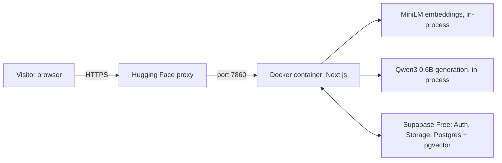

# Hugging Face deployment (free)

[Documentation index](README.md) · [Release strategy](release.md) · [Configuration](configuration.md)

This deploys the full RAG app to a **free Hugging Face Docker Space** (CPU basic: 2 vCPU, 16 GB RAM). Supabase stays on its Free plan. No credit card, GPU, Ollama or paid API is needed.

## How it fits together



One Node.js process does everything the local app did. The Dockerfile bakes both models into the image at build time; nothing is downloaded at runtime.

| File | Role |
| --- | --- |
| `Dockerfile` | Installs locked dependencies, prepares models, builds Next.js, starts it on port 7860 as user 1000 |
| `.dockerignore` | Keeps `.env*`, `.git`, `node_modules`, `.next` and `.setup-cache` out of the image |
| `README.md` front matter | Tells Hugging Face this is a Docker Space on port 7860 |
| `scripts/deploy-space.mjs` | Pushes a binary-free snapshot of a committed branch to the Space |

## 1. Prepare Supabase

A separate free demo project is recommended so public visitors never share a database with your personal documents.

1. Create the project, then in **SQL Editor** run, in order, the four files in `supabase/migrations/` and `supabase/storage/documents.sql`. See [Supabase setup](supabase-setup.md).
2. **Authentication → URL Configuration**: set Site URL to `https://<username>-<space>.hf.space` and add `https://<username>-<space>.hf.space/auth/callback` to Redirect URLs.
3. **Authentication → Sign In / Providers → Email**: the built-in email sender only delivers to your project team and a few emails per hour, so visitors would never receive confirmation emails. For a demo, turn **Confirm email** off, or configure a free SMTP provider.
4. Copy the project URL and the **publishable** key (`sb_publishable_…`). Never use a service-role or secret key.

## 2. Create the Space

On huggingface.co: **New Space** → SDK **Docker** → template **Blank** → hardware **CPU basic (free)** → visibility **Public**.

## 3. Add Space variables

**Settings → Variables and secrets → New variable** (variables, not secrets — the two Supabase values are publishable, and Hugging Face passes variables to the Docker build):

| Name | Value |
| --- | --- |
| `NEXT_PUBLIC_SUPABASE_URL` | Your demo project URL |
| `NEXT_PUBLIC_SUPABASE_PUBLISHABLE_KEY` | Your demo project publishable key |

Optional overrides (the Dockerfile already sets these defaults): `LOCAL_MODEL_ID` (`qwen3-0.6b`), `GENERATION_TIMEOUT_MS` (`180000`), `PUBLIC_DEMO` (`true`).

## 4. Push the code

Create a free **write** access token in Hugging Face **Settings → Access Tokens**. Then, from the repository root, add the Space as a second remote (once):

```bash
git remote add space https://huggingface.co/spaces/<username>/<space>
```

Preview what will be sent, then deploy the committed branch:

```bash
npm run deploy:space -- space feat/embedded-llm --dry-run
```

```bash
npm run deploy:space -- space feat/embedded-llm
```

Hugging Face rejects binary files pushed with plain git, so `scripts/deploy-space.mjs` pushes a one-commit snapshot of the branch without `docs/screenshots` and without git history. Your own branches and GitHub are not changed. Only committed, tracked files are sent; `.env.local` never is. When git asks, use your Hugging Face username and the token as the password. The Space builds automatically; watch **Logs → Build**. The first build downloads about 1 GB of model files and takes several minutes.

## 5. Verify

Open `https://<username>-<space>.hf.space` directly (the Space page on huggingface.co shows the app in an iframe, which this app deliberately blocks and where login cookies would not work anyway).

- Sign up / sign in.
- Upload a PDF → **Process for AI** → **Ready**.
- Ask a Documents question: the answer streams word by word and shows sources.
- Ask something unrelated: Documents mode reports insufficient information.
- Try General AI mode.
- The badge shows **Local AI · Qwen3 0.6B**; Settings → Local AI reports the model available.

## Free-tier behaviour

- The Space sleeps after about 48 hours without visitors and wakes on the next visit; the first answer after waking is slower while the model loads.
- Supabase Free pauses a project after 7 days of inactivity; resume it free from the dashboard.
- One answer is generated at a time; others see "busy, try again".
- Expect roughly 25–45 seconds per document answer on 2 shared vCPUs. `qwen3-1.7b` answers better but slower.

## Test the image locally (optional)

With Docker Desktop running:

```bash
docker build -t groundwork --build-arg NEXT_PUBLIC_SUPABASE_URL=<url> --build-arg NEXT_PUBLIC_SUPABASE_PUBLISHABLE_KEY=<key> .
```

```bash
docker run --rm -p 7860:7860 groundwork
```

Then open `http://localhost:7860`. Add `http://localhost:7860/auth/callback` to Supabase redirect URLs if you test sign-up confirmation locally.
